

  

  
  

Software Engineer at **ZIRA**, based in Bosnia and Herzegovina. I build full-stack products end to end: .NET backends, Angular and Next.js frontends, Flutter apps, and fast, hand-made websites with no heavy frameworks.

## Featured

<table>
  <tr>
    <td width="50%" valign="top">
      <a href="https://myshishapedia.com">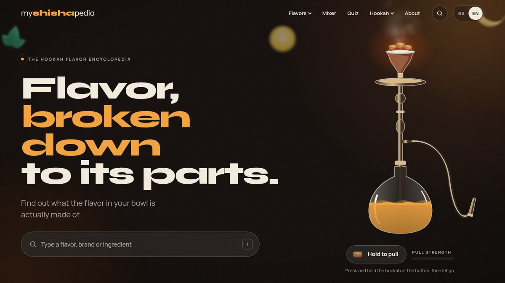</a>
       <strong><a href="https://myshishapedia.com">MyShishapedia</a></strong>
       Hookah flavour encyclopedia. What each flavour is made of, similar flavours, mix recipes, a mixer and a quiz. 183 flavours from 20 brands, built with a custom static site generator.
       <a href="https://myshishapedia.com">live</a> · <a href="https://github.com/grabator/myshishapedia">source</a> · <code>JavaScript</code> <code>Cloudflare Pages</code> <code>D1</code>
    </td>
    <td width="50%" valign="top">
      <a href="https://squadjury.com">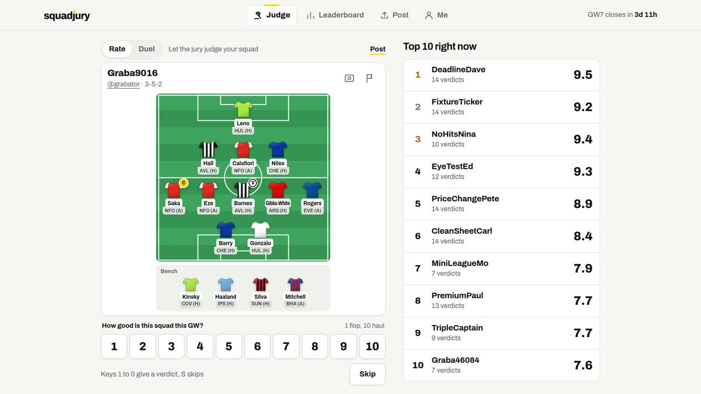</a>
       <strong><a href="https://squadjury.com">SquadJury</a></strong>
       FPL managers post their squad with one screenshot, read by OCR in the browser, and the community rates it before the deadline. Duels with Elo, private leagues, real points after each gameweek.
       <a href="https://squadjury.com">live</a> · <a href="https://github.com/grabator/squadjury">source</a> · <code>JavaScript</code> <code>Cloudflare Workers</code> <code>D1</code> <code>R2</code>
    </td>
  </tr>
</table>

## Websites and apps

<table>
  <tr>
    <td width="33%" valign="top">
      <a href="https://beauty-salon.grabafaceit.workers.dev">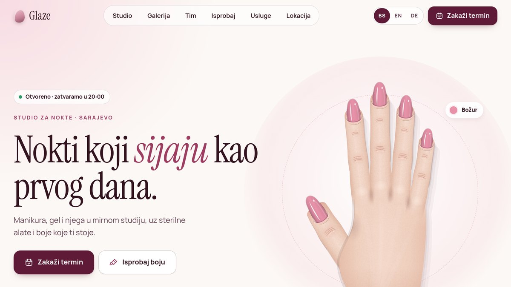</a>
       <strong><a href="https://beauty-salon.grabafaceit.workers.dev">Glaze Nail Studio</a></strong>
       Nail salon. Try a polish on a realistic SVG hand and book in three steps.
       <a href="https://beauty-salon.grabafaceit.workers.dev">live</a> · <a href="https://github.com/grabator/beauty-salon">source</a>
    </td>
    <td width="33%" valign="top">
      <a href="https://ashiana-cafe.grabafaceit.workers.dev">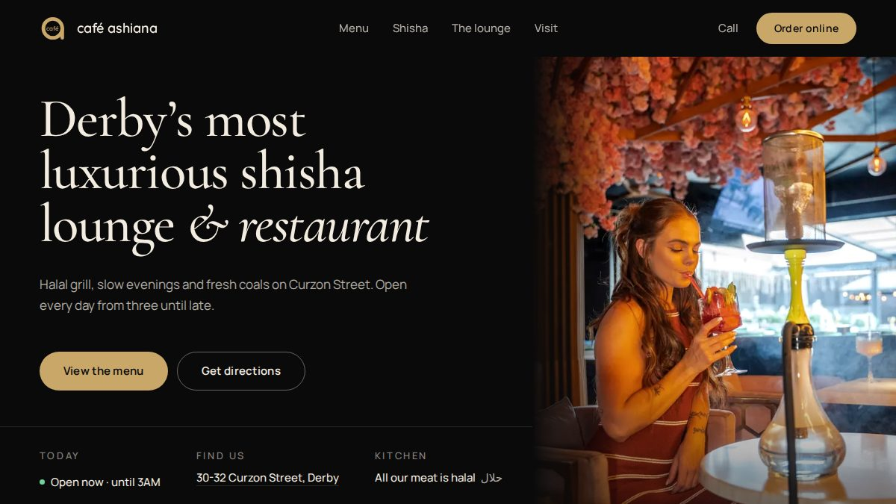</a>
       <strong><a href="https://ashiana-cafe.grabafaceit.workers.dev">Café Ashiana</a></strong>
       Shisha lounge in Derby. Full menu with search, shisha list, live open status.
       <a href="https://ashiana-cafe.grabafaceit.workers.dev">live</a> · <a href="https://github.com/grabator/ashiana-cafe">source</a>
    </td>
    <td width="33%" valign="top">
      <a href="https://rezervacije-production-6f84.up.railway.app/r/exclusive/rezervacije">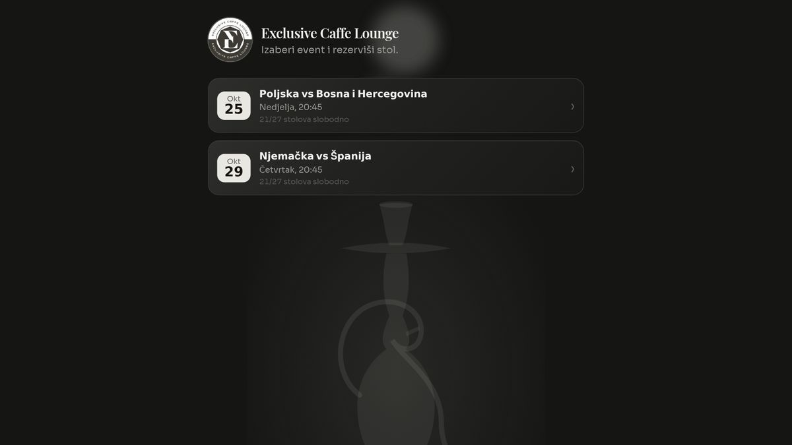</a>
       <strong><a href="https://rezervacije-production-6f84.up.railway.app/r/exclusive/rezervacije">Exclusive Lounge</a></strong>
       Pick your exact table on a floor plan. Admin panel and Telegram alerts.
       <a href="https://rezervacije-production-6f84.up.railway.app/r/exclusive/rezervacije">live</a> · <a href="https://github.com/grabator/exclusive-lounge-caffe-rezervacije">source</a>
    </td>
  </tr>
  <tr>
    <td width="33%" valign="top">
      <a href="https://svecana-sala.grabafaceit.workers.dev">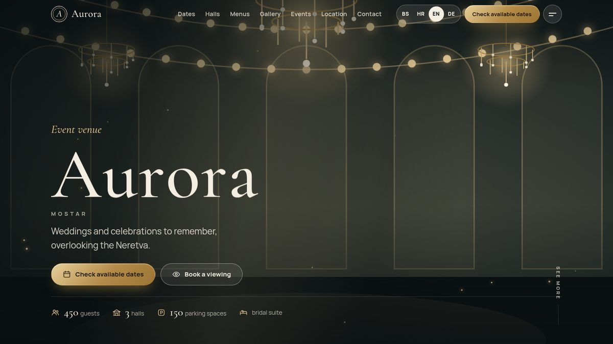</a>
       <strong><a href="https://svecana-sala.grabafaceit.workers.dev">Svečana sala Aurora</a></strong>
       Wedding venue demo. Dates synced from Google Calendar, price estimate, guest QR.
       <a href="https://svecana-sala.grabafaceit.workers.dev">live</a> · <a href="https://github.com/grabator/svecana-sala">source</a>
    </td>
    <td width="33%" valign="top">
      <a href="https://planinka.grabafaceit.workers.dev">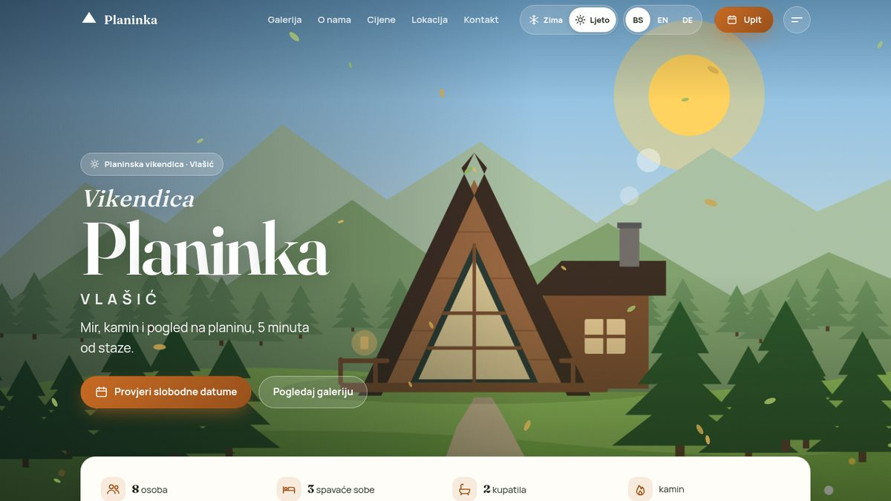</a>
       <strong><a href="https://planinka.grabafaceit.workers.dev">Planinka</a></strong>
       Mountain cabin on Vlašić. Seasonal prices, stay calculator, live weather.
       <a href="https://planinka.grabafaceit.workers.dev">live</a> · <a href="https://github.com/grabator/planinka">source</a>
    </td>
    <td width="33%" valign="top">
      <a href="https://casamontanavlasic.com">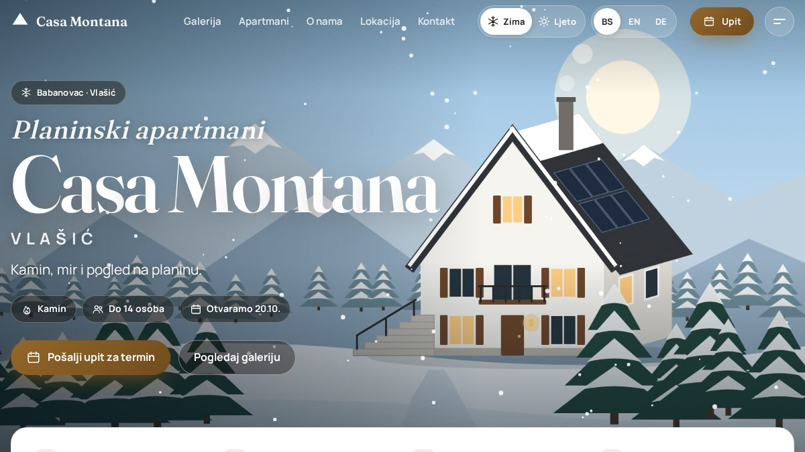</a>
       <strong><a href="https://casamontanavlasic.com">Casa Montana</a></strong>
       Mountain apartments on Vlašić. Real photos and video, inquiries on Viber and WhatsApp, three languages.
       <a href="https://casamontanavlasic.com">live</a> · <a href="https://github.com/grabator/casa-montana">source</a>
    </td>
  </tr>
  <tr>
    <td width="33%" valign="top">
      <a href="https://harmonija.grabafaceit.workers.dev">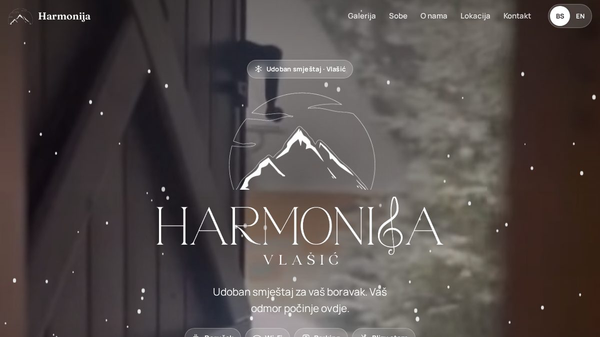</a>
       <strong><a href="https://harmonija.grabafaceit.workers.dev">Harmonija</a></strong>
       New site proposal for holiday rooms on Vlašić, with their own photos and video.
       <a href="https://harmonija.grabafaceit.workers.dev">live</a> · <a href="https://github.com/grabator/harmonija">source</a>
    </td>
    <td width="33%" valign="top">
      <a href="https://github.com/grabator/old-bridge-mostar">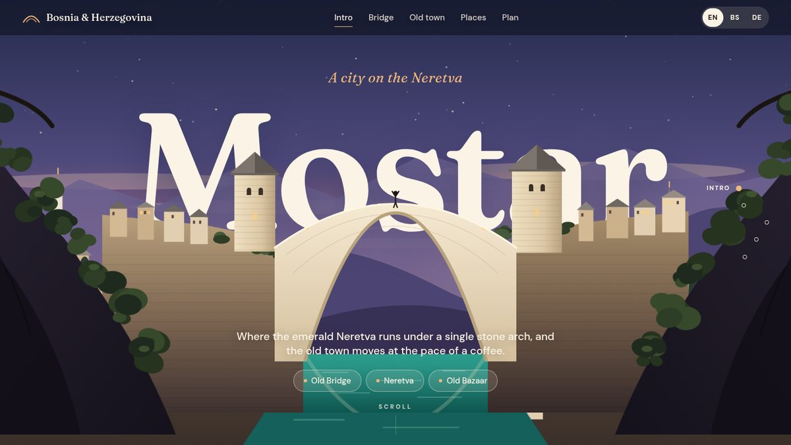</a>
       <strong><a href="https://github.com/grabator/old-bridge-mostar">Old Bridge Mostar</a></strong>
       Cinematic scroll story with layered SVG scenes of the Old Bridge.
       <a href="https://github.com/grabator/old-bridge-mostar">source</a>
    </td>
    <td width="33%" valign="top">
      <a href="https://graba-portofolio.grabafaceit.workers.dev">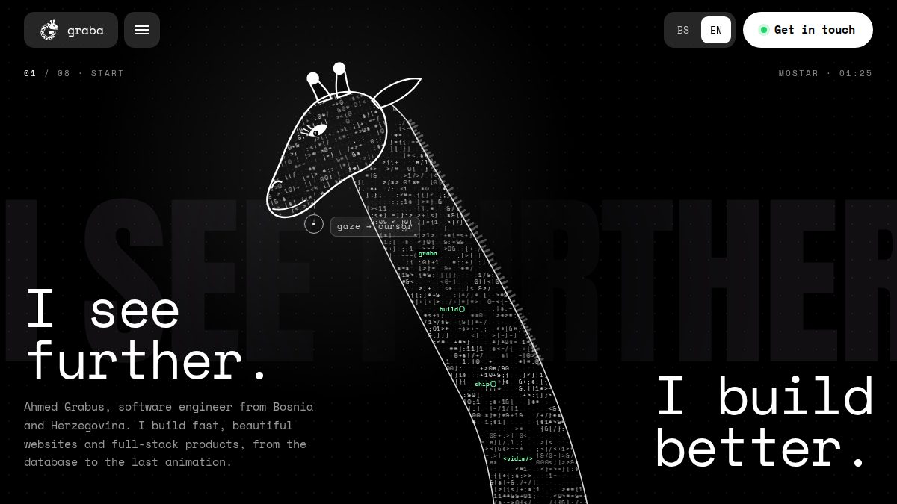</a>
       <strong><a href="https://graba-portofolio.grabafaceit.workers.dev">Portfolio</a></strong>
       A giraffe made of code follows your cursor. On mobile, a 3D room.
       <a href="https://graba-portofolio.grabafaceit.workers.dev">live</a> · <a href="https://github.com/grabator/graba-portofolio">source</a>
    </td>
  </tr>
</table>

## Also building

<table>
  <tr>
    <td width="50%" valign="top">
      <strong><a href="https://github.com/grabator/IB210176-seminarski-rs2">GrabPoints</a></strong>
       FPL companion with ML predictions for points, captains and transfers. .NET 10 API and worker over RabbitMQ, Flutter mobile app and desktop admin.
       <code>.NET 10</code> <code>RabbitMQ</code> <code>ONNX</code> <code>Flutter</code> <code>Docker</code>
    </td>
    <td width="50%" valign="top">
      <strong><a href="https://github.com/grabator/dezurne-apoteke">Dežurne apoteke BiH</a></strong>
       Which pharmacies are on duty right now in Bosnia and Herzegovina, with distance, one-tap calling and directions.
       <code>Next.js 16</code> <code>React 19</code> <code>PWA</code>
    </td>
  </tr>
</table>

## Tech stack

                 

